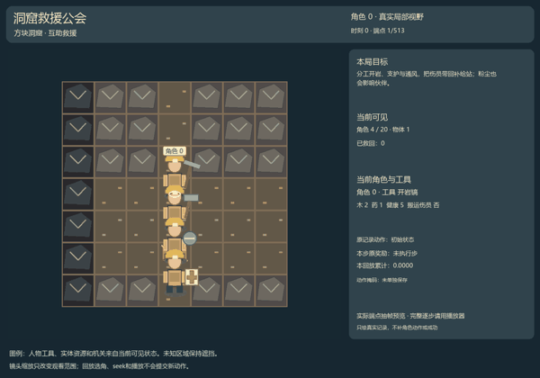

# Crucibles_JAXMARL

[](https://github.com/hl682/Crucibles_JAXMARL/actions/workflows/ci.yml)
[](https://hl682.github.io/Crucibles_JAXMARL/)

Existing Crucibles multi-agent games, packaged as a native JAX library with
explicit PRNG keys, pure transitions, agent-keyed spaces and local human/AI play.
The collection contains **180 spatial game identities (GI072–251)** and
**76 historical abstract resource/communication games** (GI000–071 plus the four original window-v1 candidates, v1_000–v1_003), with 256
distinct registered source hashes. Alternate versions are preserved separately
and are not counted as additional games.

**[Browse all games and actual verification](https://hl682.github.io/Crucibles_JAXMARL/)** ·
**[Installation and play](https://hl682.github.io/Crucibles_JAXMARL/guide.html)** ·
**[JAX API](https://hl682.github.io/Crucibles_JAXMARL/api.html)**



The worlds explore complementary work, private information, communication,
shared resources, competing interests and delayed commitments. Each game keeps
its original population, map, horizon, rewards and information contract. The
early abstract family has no native spatial map and is presented honestly as
resource/observation displays. New artwork or animation never changes physics.

## Install and run

Python **3.12** is the tested version. Python metadata allows 3.10–3.12;
other versions are not claimed as tested. The numerical dependencies are pinned
to JAX/jaxlib 0.4.38 and NumPy 1.26.4. Use a virtual environment.

```sh
git clone https://github.com/hl682/Crucibles_JAXMARL.git
cd Crucibles_JAXMARL
python -m venv .venv
```

Activate with `.venv\Scripts\activate` on Windows or
`source .venv/bin/activate` on Linux, then:

```sh
python -m pip install -e .
crucibles smoke --game 225
crucibles play --game 225
```

Alternatively, `start.cmd` on Windows or `bash start.sh` on Linux creates the
environment, installs the package and launches the default game. After initial
installation, **`crucibles play --game 225`** is the single launch command.

Keep the terminal running and open the exact HTTP URL it prints. A ready server
exposes `/health`. If the port is occupied, use `--port 8766`; no other process
is terminated. A `file://` document cannot start JAX. Stopping the server ends
in-memory sessions while preserving logs. The public Pages site contains static
documentation and genuine saved demonstrations; it does not run Python/JAX.

## Local human/AI play

Create a session with a seed. Assign any role or set of roles to Host or to an
invited local participant. Each role has its own legal-command selector and
native observation. Queue commands, then advance the joint step. Arrow keys or
WASD queue declared MOVE/WALK commands; Space advances the step. Roles without a
queued command use the explicitly labelled **untrained uniform-legal AI**.

Take over or release any roles before the next step without resetting the world
or accumulated returns. Assign all roles for one-person team control. Invitations
allow another browser tab or browser on the same computer to control a separate
subset. The Host controls the clock. Role populations are not reduced or capped
by the UI. For participants on separate computers on the same network, run
`crucibles play --game 225 --bind 0.0.0.0`. Open the printed LAN address on the
Host computer before creating invitations, so invitation URLs use that reachable
address. Other participants open their invitation URL on their own computer.
The default remains local-only. Public Internet hosting is not bundled.

Full-state debug is a separate, labelled Host camera and is permanently logged
as an information condition. It is not a blind benchmark. Four concurrent
sessions bound local compilation memory. The API supports closing sessions;
logs persist. Session state is not checkpointed across server restarts.

## JAX training API

```python
import jax
from crucibles_jaxmarl import make

env = make("gi072")
key = jax.random.PRNGKey(0)
key, reset_key, action_key, step_key = jax.random.split(key, 4)
obs, state = jax.jit(env.reset)(reset_key)
actions = env.sample_actions(action_key, state)
obs, state, rewards, dones, info = jax.jit(env.step_env)(
    step_key, state, actions
)
done = dones["__all__"]
```

- `reset(key)`: agent-keyed observations and original state PyTree.
- `step_env(key, state, actions)`: raw transition, preserving terminal state.
- `step(...)`: terminal-triggered outer autoreset, with raw terminal data in
  `info['raw_state']` and `info['raw_observation']`.
- `get_avail_actions(state)`, `sample_actions(key, state)`, `get_obs(state)`:
  original masks, legal sampling and native observations.
- `action_space(agent)`, `observation_space(agent)`, `agents`, `agent_classes`:
  role/space metadata.
- `raw_step`, `observe`, `legal_actions`: original array interface.

JIT, vmap and scan compose with the pure interface. Batch the same identity and
shape; heterogeneous game shapes require grouping or an explicit learner-side
padding contract. Host rendering stays outside compiled training. This supports
future recurrent and meta-RL integration without claiming a DiscoRL integration,
learning result, differentiability of discrete dynamics, transfer or convergence.
The facade follows the [official JaxMARL API](https://jaxmarl.foersterlab.com/api/multi_agent_env/)
and is independent of upstream registration or certification.

## Evidence and benchmarks

`verification/giNNN.json` records each game's actual eager/JIT execution, space
and legal-mask checks, measured floating differences, integer parity, vmap,
original-horizon episode, rewards, termination, outer reset and all-role render
filtering. `verification/browser/giNNN.json` records real Chromium DOM commands,
multiple participants, ownership, takeover and release to AI against the native
Python server. Statuses remain separate until their checks have actually run.
The public pages reproduce these receipts rather than treating source import
or a screenshot as playability evidence.

Each session writes a hash-chained action/reward/takeover log with source hash,
manifest hash, version, seed, control history and debug exposure. Finished
sessions write `benchmark.json`. Engineering tests use `--engineering`.
**Human scores remain `null`**: software inputs are not human participants and
the server does not independently verify human identity. Mixed, AI-only and
human-input histories remain distinct; returns are not attributed solely to the
last controller or aggregated across unrelated games.

Historical research evidence remains unchanged. In particular, GI226/227's
original floating reset differences and failed/zero-effect tracks remain
numerically undetermined, and GI229's original comparison remains undetermined.
Release engineering checks do not revise scientific acceptance. No old training
matrix was resumed and no new game was generated for this release.

Original saved previews are published as small documented derivatives, with
original hashes, frame counts and exact sampled indices in
`verification/original_preview_derivatives.json`. Fresh complete action/reward
traces are stored in `verification/traces/`; `tools/verify_game.py` rebuilds the
release demonstration from the bundled source and recorded seed. Large original
raw research archives are not runtime dependencies.

## Reproduce verification

```sh
python -m pip install -e ".[dev]"
python tools/verify_all.py --workers 2
python -m playwright install chromium
python tools/verify_browser.py
python tools/build_docs.py
python tools/check_release.py
python -m build
```

Linux full-collection CI is sharded; Windows and Linux CI also check installation
and browser integration. See actual CI results for platform evidence. CPU is the
release validation target; CUDA and TPU are not claimed as tested. Per-game
full episodes are engineering probes, not evidence that arbitrary random agents
can achieve each game's cooperative objective or that humans find it usable.

## License and provenance

Apache 2.0; see [LICENSE](LICENSE), [NOTICE](NOTICE) and
[CONTRIBUTING.md](CONTRIBUTING.md). Every registered game ships its source,
manifest, mechanism and available scene metadata. Two alternative original
versions are retained in `source-history/`. No commercial game artwork, research
chats, SSH credentials, model weights or global/H-drive runtime dependencies are
required or included.

Installation, API structure and documentation were reviewed against
[JaxMARL](https://github.com/bold-lab-ai/JaxMARL) and
[its documentation](https://jaxmarl.foersterlab.com/). This is an independent
Crucibles library; upstream performance claims do not apply to this collection.
