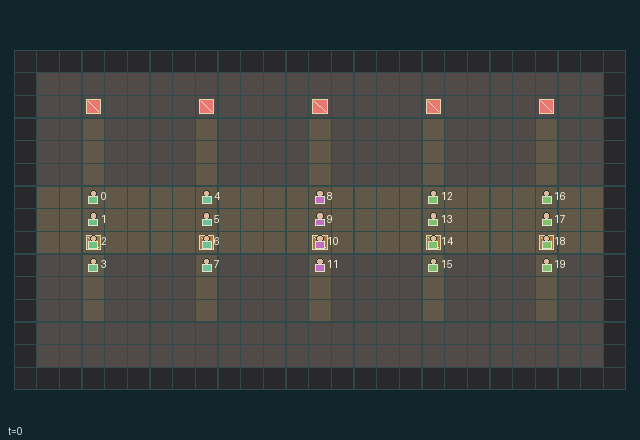

# Crucibles_JAXMARL

[English](README.md) · **中文说明**

保留原始源码的原生多智能体游戏库，具有显式随机密钥、纯状态转移、逐角色空间接口和本地人机游玩。共登记 **256 个不同源码身份**：**180 款空间游戏**，以及 **76 款历史抽象交互游戏**。早期四款使用独立版本标识，不与第二代同序号游戏混同；历史替代源码单独保留，不增加游戏数。

**[全部游戏动态目录](https://hl682.github.io/Crucibles_JAXMARL/zh/#collection)** · **[安装操作](https://hl682.github.io/Crucibles_JAXMARL/zh/guide.html)** · **[训练接口](https://hl682.github.io/Crucibles_JAXMARL/zh/api.html)** · **[完整设计与分类依据](https://hl682.github.io/Crucibles_JAXMARL/zh/design.html)**

[](https://hl682.github.io/Crucibles_JAXMARL/zh/games/gi222.html)

全部游戏都有自己的动图和中英文说明书，包含名称、解释、玩法、理念、操作、原始接口与强化学习训练指引。**游戏界面和动图文字固定英文，说明书在同一款页面切换中英文。**说明面板已移至说明书，不烘焙在当前游戏图片中。

动图重放保存的未训练合法动作轨迹，使用原内核的真实端点与完整状态调试视角，不表示任务已解出或方法已学会。旧定制录像及失败、零效应、不确定性作为档案保留。抽象游戏显示原生状态，不虚构地形。

## 安装与启动

已测试 Python 3.12，元数据允许 3.10 至 3.12。固定数值依赖为 JAX/jaxlib 0.4.38、NumPy 1.26.4。请使用虚拟环境。

```sh
git clone https://github.com/hl682/Crucibles_JAXMARL.git
cd Crucibles_JAXMARL
python -m venv .venv
```

Windows 运行 `.venv\Scripts\activate`，Linux 运行 `source .venv/bin/activate` 后执行：

```sh
python -m pip install -e .
crucibles smoke --game 225
crucibles play --game 225
```

也可以在 Windows 双击 `start.cmd`，或在 Linux 运行 `bash start.sh`，完成初次安装并启动。以后只需启动命令。保持终端开启，打开打印的准确网址。端口占用时改用 `--port 8766`。公开网站显示保存的动图和说明书；实时转移由本机运行。

## 本地人机与多人操作

**GI215 厨房实时操作：**运行 `crucibles play --game 215`，或在 Windows
双击 `play_bistro.cmd`，保持终端开启，在页面点击 **Play now**。
两名角色会交给你控制。点击角色切换，WASD 移动，点击身边的物品或工作台执行
真实动作。启用 **Direct controls** 时，每次指令推进一步，另一名由你控制的
厨房角色等待；关闭后可分别排队两人的动作，再共同推进。也可把角色分配给
另一位参与者。释放控制的角色使用页面标明的未训练 AI。

这款沿用原有厨房画面，洗碗、加工、装汤与完成订单的表现由真实 JAX 状态驱动。
目前已核验一单流程：清洁角色洗碗并交接，厨师加工、装汤和上菜。
这是一段工程操作验证，不是人类基准分，也不代表全部 256 款的游戏性已验收。

建局后，把任意角色集合分配给主持人或受邀参与者，每个角色都有合法指令选择器和原生观察，没有人口缩减或角色上限。先排队动作，再同时推进。方向键或 WASD 排队已声明的方向动作，空格推进；具体阶段与掩码仍生效。未排队角色由明确标注的未训练合法均匀采样策略操作。

下一步前可接管或释放角色，不重置世界和累计回报。邀请链接允许第二标签页或另一参与者控制不同角色，主持人控制时钟。局域网其他电脑参与时运行：

```sh
crucibles play --game 225 --bind 0.0.0.0
```

主持人先打开打印的局域网地址，再建立邀请。默认仅本机监听，不提供公网托管。完整状态调试视角是单独标注的主持人权限，开启后永久记入日志，不能当作盲测。最多四个并存会话限制编译内存。关闭会话保留日志，重启服务不恢复内存会话。

## 强化学习接口

```python
import jax
from crucibles_jaxmarl import make

env = make("gi072")
key = jax.random.PRNGKey(0)
key, rk, ak, sk = jax.random.split(key, 4)
obs, state = jax.jit(env.reset)(rk)
actions = env.sample_actions(ak, state)
obs, state, rewards, dones, info = jax.jit(env.step_env)(sk, state, actions)
done = dones["__all__"]
```

角色观察、动作、奖励和结束标记均按角色索引。不自动重置接口保留终止数据；外层自动重置接口在信息字典保留原状态和观察。掩码、合法采样、空间描述和原生数组接口均可调用。同身份同形状可以编译、批处理或扫描；异形状明确分组或声明填充方案，不能缩减原人口和时限。渲染在主机侧，不进入训练图。

每款说明书提供针对其机制的训练问题和评测注意事项。参数共享、记忆、通信、集中价值网络、伙伴适应和奖励塑形是须明确说明的实验因素。接口不构成学习、收敛、迁移、元梯度正确性或离散动力学可微性的结果。

## 证据与来源

初版工程档案记录全部 256 款原生完整回合检查、256 款真实浏览器控制检查及 180 款空间键盘检查。179 款即时与编译结果完全一致，77 款有实测非零浮点差异，数值结论仍未定。人类成绩为空、未核验；没有训练增益声明。

新的逐款展示回执保存在 `verification/presentation/`，记录原轨迹、源码、端点、图片哈希和奖励差异，不引入数值验收容差。全部原始内核与清单按哈希核对；旧大型运河、森林与厨房回放保留完整端点和播放器，可从相关说明书下载。

设计说明解释持久后果、实体交互、信息权限和差异激励，以及七类可重叠机制标签的依据与边界。分类是可复查的编辑辅助，不是难度排名或策略等价证明。

许可为 Apache 2.0，来源记录随各款源码保存。软件工程验证与科学结果分别记录。
